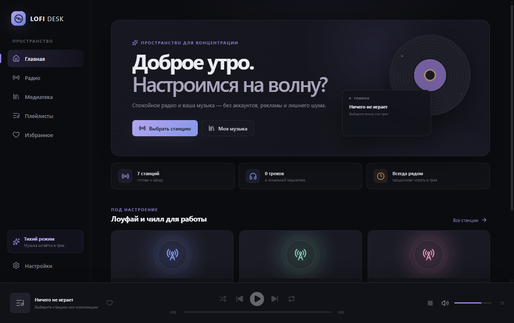

# LOFI DESK

[](https://github.com/markKikhtenko/LOFI-DESK/actions/workflows/ci.yml)
[](https://github.com/markKikhtenko/LOFI-DESK/releases/latest)
[](LICENSE)

LOFI DESK — открытый настольный музыкальный плеер для Windows: локальная медиатека и спокойное интернет-радио в минималистичном тёмном интерфейсе. Приложение не требует аккаунта или отдельного сервера, а локальная музыка работает без интернета.



## Возможности

- семь официальных прямых MP3-потоков SomaFM: Groove Salad, Beat Blender, Vaporwaves, Lush, Drone Zone и другие chill-станции;
- собственные станции по URL, избранное, индикация соединения и повторное подключение;
- метаданные текущего эфира SomaFM;
- рекурсивное сканирование MP3, FLAC, WAV и OGG, теги и встроенные обложки;
- поиск, очередь, shuffle, repeat, перемотка, плейлисты и избранное;
- сохранение громкости, состояния библиотеки и пользовательских настроек;
- мультимедийные клавиши Windows, фоновое воспроизведение и системный трей;
- подписанные обновления через Tauri Updater и GitHub Releases.

## Системные требования и установка

- Windows 10/11 x64;
- Microsoft Edge WebView2 Runtime (установщик скачает bootstrapper, если runtime отсутствует);
- интернет только для радио, проверки обновлений и первоначальной загрузки WebView2.

Скачайте `.exe` со страницы [последнего выпуска](https://github.com/markKikhtenko/LOFI-DESK/releases/latest) и запустите установщик. Установка выполняется для текущего пользователя и не требует прав администратора. Ярлык создаётся в меню «Пуск»; удаление доступно в стандартном разделе приложений Windows.

Сертификат Windows Authenticode пока не подключён, поэтому SmartScreen может предупредить о неизвестном издателе. Пакеты автоматических обновлений отдельно подписаны ключом Tauri и проверяются приложением до установки.

## Использование

В разделе «Радио» выберите станцию или добавьте прямой URL потока MP3/AAC. В «Медиатеке» нажмите «Добавить папку»: приложение найдёт музыку во вложенных каталогах, прочитает теги и обложки. Меню `⋯` у трека добавляет его в созданный плейлист.

Закрытие главного окна скрывает LOFI DESK в системный трей — воспроизведение продолжается. Для полного завершения выберите «Выйти» в меню трея. Перемотка недоступна для прямого радиоэфира и автоматически отключена.

## Форматы и источники радио

Локально поддерживаются MP3, FLAC, WAV и OGG в пределах кодеков Windows WebView2. Начальный радиокаталог использует официальные персональные потоки [SomaFM](https://somafm.com/listen/); условия SomaFM запрещают ретрансляцию и коммерческое встраивание потоков. Пользовательские станции должны предоставлять прямой MP3/AAC URL с HTTPS.

## Архитектура

```text
src/
├── components/     интерфейс и постоянная панель плеера
├── data/           встроенный каталог станций
├── hooks/          аудиодвижок, Media Session и updater
├── pages/          разделы приложения
├── services/       мост React ↔ Tauri
├── stores/         локальное состояние Zustand
└── types/          доменные типы
src-tauri/
├── capabilities/   минимальные разрешения Tauri
├── icons/          иконки приложения и установщика
└── src/             сканер файлов, метаданные, HTTP и трей
```

React управляет интерфейсом, очередью и HTML-аудио. Rust рекурсивно сканирует выбранные папки через `walkdir`, читает теги через `lofty`, ограниченно получает метаданные SomaFM и выдаёт runtime-доступ asset protocol только к выбранным папкам. Настройки, плейлисты и индекс сохраняются в изолированном local storage WebView2.

## Локальная разработка

Понадобятся Node.js 24+, Rust stable, Microsoft C++ Build Tools и WebView2.

```powershell
git clone https://github.com/markKikhtenko/LOFI-DESK.git
cd lofi-desk
npm ci
npm run tauri dev
```

Проверки:

```powershell
npm run typecheck
npm run lint
npm test
npm run build
cargo fmt --manifest-path src-tauri/Cargo.toml --all -- --check
cargo clippy --manifest-path src-tauri/Cargo.toml --all-targets -- -D warnings
cargo test --manifest-path src-tauri/Cargo.toml
```

## Сборка NSIS

Из-за `createUpdaterArtifacts: true` production bundle требует ключ подписи обновлений:

```powershell
$env:TAURI_SIGNING_PRIVATE_KEY = "$env:USERPROFILE\.lofi-desk-secrets\updater.key"
$env:TAURI_SIGNING_PRIVATE_KEY_PASSWORD = ""
npm run tauri build -- --bundles nsis
```

Установщик появится в `src-tauri/target/release/bundle/nsis/`. Пользовательские данные хранятся отдельно от программы и сохраняются при обновлении. Для полной ручной очистки после удаления можно удалить WebView2-профиль приложения в `%LOCALAPPDATA%\com.markkikhtenko.lofidesk` (если каталог существует).

## Обновления и CI/CD

`ci.yml` при push и pull request проверяет TypeScript, ESLint, unit-тесты, frontend, Rust и production-компиляцию Tauri. `release.yml` запускается по тегу `v*` или вручную, проверяет синхронность версий, требует секрет подписи, собирает NSIS и публикует установщик, `.sig` и `latest.json`.

Приложение неблокирующе проверяет `latest.json` при запуске и вручную в настройках, показывает SemVer и changelog, загружает обновление с прогрессом и перед установкой проверяет криптографическую подпись. Подробная безопасная процедура: [docs/RELEASING.md](docs/RELEASING.md).

Необходимые GitHub Actions Secrets:

- `TAURI_SIGNING_PRIVATE_KEY` — содержимое приватного ключа Tauri;
- `TAURI_SIGNING_PRIVATE_KEY_PASSWORD` — пароль ключа, если задан.

## Версионирование и ограничения

Версии синхронизированы между `package.json`, `src-tauri/Cargo.toml` и `src-tauri/tauri.conf.json`; история находится в [CHANGELOG.md](CHANGELOG.md).

Известные ограничения версии 0.2.1:

- метаданные пользовательских радиоэфиров не читаются без отдельного metadata endpoint;
- набор доступных аудиокодеков зависит от WebView2/Windows;
- автоматическое обновление можно полноценно проверить только после публикации следующей версии;
- установщик не имеет Authenticode-сертификата.

## Лицензия

[MIT](LICENSE). Аудиозаписи и контент радиостанций в репозиторий не входят и остаются собственностью соответствующих правообладателей.
